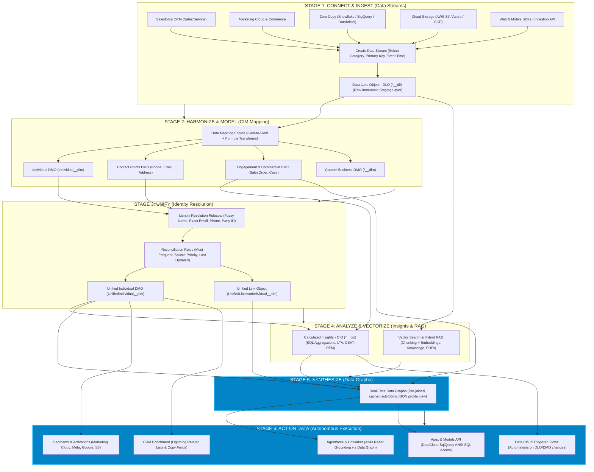

# 🌊 Salesforce Data Cloud (Data 360) End-to-End Architecture Flow
## The Complete 6-Stage Pipeline: From Ingestion to Autonomous Action
**Master Technical Reference & Field Guide — Connect ➔ Harmonize ➔ Unify ➔ Analyze ➔ Synthesize ➔ Act**

---

> [!IMPORTANT]
> **What is this guide?**
> This reference manual details the end-to-end data pipeline of **Salesforce Data Cloud (Data 360)**. It takes raw, disconnected enterprise data from multiple external and CRM sources, cleans and standardizes it into the Cloud Information Model (CIM), unifies customer identities into a single Golden Record, and exposes sub-second contextual intelligence to **Agentforce**, **Flows**, and **Omnichannel Marketing**.

---

## 🗺️ Master End-to-End Pipeline Flowchart



---

## 📋 The 6 Stages Broken Down Step-by-Step

---

### 🔌 Stage 1: Connect & Ingest (Data Streams)

The journey begins by establishing secure pipelines to stream or federate raw external and CRM data into Data Cloud.

```text
┌────────────────────────────────────────────────────────────────────────┐
│ SOURCE APPLICATION ──► DATA CONNECTOR ──► DATA STREAM ──► DLO (__dll)  │
└────────────────────────────────────────────────────────────────────────┘
```

#### 1. Select the Ingestion Connector:
* **Native Salesforce Connectors:** Salesforce CRM (Sales/Service), Marketing Cloud Engagement, B2C Commerce.
* **Storage Connectors:** Amazon S3, Google Cloud Storage, Microsoft Azure Blob.
* **API & Streaming Connectors:** Ingestion API (REST), Web SDK, Mobile SDK (iOS/Android).
* **Zero Copy Federation (Data 360):** Snowflake, Google BigQuery, Databricks, AWS Redshift *(Data stays in place; Data Cloud queries via live federation without moving or duplicating raw bytes)*.

#### 2. Configure the Data Stream (Click Path):
```text
Data Cloud App ➔ Data Streams Tab ➔ Click "New" ➔ Select Source Connector
```
* **Step A: Select Object/File:** Choose the table, CSV, or CRM object (e.g. `Account`, `Contact`, `Order_History__c`).
* **Step B: Select Object Category:**
  * **Profile:** Static customer entity data that updates existing attributes (e.g. `Contact`, `Account`, `Patient`, `Subscriber`).
  * **Engagement:** Time-series behavioral interaction events (e.g. `Email Click`, `Web Purchase`, `Case Created`).
  * **Other:** Auxiliary master data (e.g. `Product Catalog`, `Store Locations`).
* **Step C: Define Primary Key & Record Modified Date:**
  * **Primary Key:** A unique identifier per row (e.g. `CustomerId`, `TransactionId`).
  * **Record Modified Date / Event Time:** Used for delta syncs and audit ordering.
* **Step D: Select Data Space:** Assign the stream to the appropriate logical partition (e.g., `default` or a branded data space).

#### 3. Output Artifact:
* **Data Lake Object (DLO):** Automatically created with the suffix **`__dll`** (e.g. `CRM_Contact_Stream__dll`).
* *Nature:* Raw, immutable, schema-on-read staging layer. Zero transformation has occurred yet.

---

### 🧬 Stage 2: Harmonize & Model (CIM Mapping)

Raw data across 10 systems uses 10 different column names (e.g., `cust_email`, `EmailAddress`, `ELECTRONIC_MAIL`). Stage 2 maps all DLO fields into the standard **Cloud Information Model (CIM)**.

```text
┌────────────────────────────────────────────────────────────────────────┐
│ DLO (*__dll) ──► DATA MAPPING ENGINE (Transforms) ──► DMO (*__dlm)     │
└────────────────────────────────────────────────────────────────────────┘
```

#### 1. Open the Data Mapping Canvas:
```text
Data Streams Tab ➔ Select your Data Stream ➔ Click "Review Mapping" (or Data Mapping Canvas)
```

#### 2. Map to Standard Data Model Objects (DMOs):
Drag and drop fields from your source DLO to the target standard DMO entities:
* **Individual DMO (`Individual__dlm`):** Stores core profile data (`FirstName`, `LastName`, `BirthDate`).
* **Contact Points:**
  * **Contact Point Phone (`ContactPointPhone__dlm`):** Phone numbers with country codes.
  * **Contact Point Email (`ContactPointEmail__dlm`):** Email addresses and opt-in statuses.
  * **Contact Point Address (`ContactPointAddress__dlm`):** Mailing/shipping physical addresses.
* **Engagement & Commercial DMOs:**
  * **Sales Order DMO (`SalesOrder__dlm`):** E-commerce and ERP purchase orders.
  * **Case DMO (`Case__dlm`):** Support tickets and service interactions.
* **Custom DMOs (`*__dlm`):** Created when proprietary business entities don't fit CIM.

#### 3. Formula Fields & Transformations:
* Apply inline formula expressions to clean data (e.g. `UPPER(TRIM(source.email))`, formatting phone strings, or converting date-time formats).

#### 4. Output Artifact:
* **Data Model Objects (DMO):** Harmonized business objects suffixed with **`__dlm`**.

---

### 🤝 Stage 3: Unify (Identity Resolution & Golden Record)

Now that contact data is harmonized, Stage 3 links records belonging to the same human across disparate systems (e.g., matching a website visitor cookie, a loyalty member ID, and a CRM Contact).

```text
┌────────────────────────────────────────────────────────────────────────┐
│ DMOs ──► MATCH RULES ──► RECONCILIATION RULES ──► UNIFIED INDIVIDUAL   │
└────────────────────────────────────────────────────────────────────────┘
```

#### 1. Configure Match Rulesets:
```text
Identity Resolution Tab ➔ Click "New Ruleset" ➔ Select Primary DMO ("Individual")
```
Define deterministic and probabilistic matching criteria:
* **Rule 1 (Exact Match):** `Party Identification (e.g. SSN or National ID)`
* **Rule 2 (High Confidence):** `Normalized Email + Normalized Phone`
* **Rule 3 (Fuzzy Match):** `Fuzzy First Name + Exact Last Name + Normalized Email`
* **Rule 4 (Address Match):** `Normalized Street Address + Exact Phone`

#### 2. Configure Reconciliation Rules (Tie-Breaking):
When multiple source systems disagree on an attribute (e.g., CRM says Sarah's phone is `555-0100`, but Marketing Cloud says `555-0199`), reconciliation picks the truth:
* **Source Priority:** Rank trusted sources (e.g., `Service Cloud > E-Commerce > Marketing Cloud`).
* **Last Updated:** Select the most recent value.
* **Most Frequent:** Select the value present across the majority of source systems.

#### 3. Output Artifacts:
* **`UnifiedIndividual__dlm`:** The Golden Customer Record.
* **`UnifiedLinkssotIndividual__dlm`:** The cross-reference link table mapping every original source record ID to the new unified ID.

---

### 📊 Stage 4: Analyze & Enrich (Calculated Insights & Vector RAG)

Once identity is unified, we compute multi-dimensional operational metrics and vectorize unstructured content.

```text
┌────────────────────────────────────────────────────────────────────────┐
│ UNIFIED DATA ──► CALCULATED INSIGHTS (SQL) ──► CIO (*__cio)            │
│ UNSTRUCTURED ──► CHUNKING & EMBEDDINGS     ──► VECTOR INDEX            │
└────────────────────────────────────────────────────────────────────────┘
```

#### 1. Calculated Insights (CIO / `*__cio`):
Define complex rollups and behavioral metrics using ANSI SQL or the visual builder:
```sql
SELECT 
    UnifiedIndividual__dlm.Id__c as UnifiedCustomerId__c,
    SUM(SalesOrder__dlm.GrandTotalAmount__c) as LifetimeValue__c,
    MAX(SalesOrder__dlm.OrderDate__c) as LastPurchaseDate__c,
    COUNT(Case__dlm.Id__c) as TotalSupportCases__c
FROM UnifiedIndividual__dlm
JOIN UnifiedLinkssotIndividual__dlm 
    ON UnifiedIndividual__dlm.Id__c = UnifiedLinkssotIndividual__dlm.UnifiedRecordId__c
JOIN SalesOrder__dlm 
    ON UnifiedLinkssotIndividual__dlm.SourceRecordId__c = SalesOrder__dlm.SoldToCustomerId__c
GROUP BY UnifiedIndividual__dlm.Id__c
```
* Generates real-time values: **LTV**, **Churn Propensity**, **90-Day ARR**, and **Recency-Frequency-Monetary (RFM) tiers**.

#### 2. Vector Database & Hybrid Search (Unstructured RAG):
* Ingest unstructured Knowledge articles, PDF manuals, chat transcripts, and contracts.
* **Chunking Strategy:** Break text into 250–500 token semantic passages.
* **Embedding Model:** Vectorize using Salesforce Voyage / OpenAI Text-Embedding models.
* Result: Grounding database ready for semantic similarity search.

---

### ⚡ Stage 5: Synthesize (Real-Time Data Graphs)

Standard relational SQL joins across 5 tables take 800ms–2000ms—far too slow for a real-time conversational AI agent that must respond within 3 seconds!

```text
┌────────────────────────────────────────────────────────────────────────┐
│ UNIFIED PROFILE + INSIGHTS + ENGAGEMENT ──► REAL-TIME DATA GRAPH (<50ms)│
└────────────────────────────────────────────────────────────────────────┘
```

#### What is a Real-Time Data Graph?
* It is a **pre-computed, hierarchical JSON cache** materialized in memory.
* It binds the `UnifiedIndividual__dlm` with all related child entities (`ContactPoints`, `Last 5 Sales Orders`, `Open Cases`, `Calculated Insights`) into one unified document.
* **Performance:** Reduces multi-table query latency down to **sub-50 milliseconds**!

---

### 🚀 Stage 6: Act on Data (Autonomous Execution)

All the harmonized, unified, and synthesized intelligence is now delivered to the operational frontline.

```text
┌────────────────────────────────────────────────────────────────────────┐
│ REAL-TIME DATA GRAPH ──► AGENTFORCE / FLOWS / MARKETING / LIGHTNING    │
└────────────────────────────────────────────────────────────────────────┘
```

#### 1. Agentforce & Coworker Grounding:
* When a customer chats with Agentforce, the agent queries the **Real-Time Data Graph** in 30ms to instantly know their LTV, recent orders, open complaints, and SLA tier.

#### 2. Pro-Code Access via Apex (`DataCloud.SqlQuery`):
* Execute native ANSI SQL directly from transactional Apex without Connect API callout limits:
```apex
String sql = 'SELECT LifetimeValue__c, LastPurchaseDate__c FROM Customer_LTV__cio WHERE UnifiedCustomerId__c = :accId';
DataCloud.SqlQueryResult res = DataCloud.SqlQuery.query(sql);
```

#### 3. Data Cloud-Triggered Flows:
* Automatically fire a Salesforce Flow when:
  * A Calculated Insight crosses a critical threshold (e.g. `Customer Churn Score > 80`).
  * A high-value purchase event is ingested (`Order Amount > $10,000`).

#### 4. Omnichannel Segments & Activation:
* Publish audience segments to **Marketing Cloud**, **Meta Ads**, **Google Ads**, **Amazon Ads**, or external webhooks via SFTP/S3.

#### 5. Native CRM Enrichment:
* Surface Data Cloud DMOs directly on standard Lightning Record Pages as **Enriched Related Lists** (e.g. showing 5 years of external ERP orders on a Salesforce Contact page without copying data into standard CRM storage!).

---

## 🏷️ Standard Data Cloud Suffix Reference Table

| Suffix | Full Name | Layer / Stage | Example API Name | Purpose |
| :---: | :--- | :--- | :--- | :--- |
| **`__dll`** | **Data Lake Object** | Stage 1: Ingestion | `AWS_Orders_Stream__dll` | Raw immutable source data stored in the lake. |
| **`__dlm`** | **Data Model Object** | Stage 2 & 3: Harmonize/Unify | `Individual__dlm`, `SalesOrder__dlm` | Standard CIM entity mapped and harmonized. |
| **`__cio`** | **Calculated Insight Object**| Stage 4: Analysis | `Customer_Lifetime_Value__cio` | Pre-computed multi-dimensional analytical metric. |
| **`__dlr`** | **Data Lineage Record** | Audit & Governance | `Account_Lineage__dlr` | Tracks source-to-target mapping transformations. |

---

## 🎬 Real-World Walkthrough: Sarah Jenkins' Journey

Follow one customer through all 6 stages of the Data Cloud pipeline:

| Stage | What Happens in the Background | What the System Sees |
| :---: | :--- | :--- |
| **1. Connect** | Sarah buys shoes on Shopify; browses product catalog on mobile app; has an old support ticket in Service Cloud. | 3 raw streams ingested into 3 distinct DLOs (`__dll`). |
| **2. Harmonize** | Field mapping normalizes `user_email`, `cust_ph`, and `order_amt` into standard CIM schemas. | Mapped to `Individual__dlm`, `ContactPointPhone__dlm`, `SalesOrder__dlm`. |
| **3. Unify** | Identity Resolution matches her Shopify email and CRM phone number using Match Ruleset. | Created **`UnifiedIndividual__dlm`** (Single Golden ID for Sarah). |
| **4. Analyze** | Calculated Insight queries all Sarah's historical orders across both channels. | `LifetimeValue__cio` computes **$4,850** (VIP Tier). |
| **5. Synthesize** | Real-Time Data Graph compiles Sarah's profile, VIP tier, and last 3 orders into a JSON memory cache. | `DataGraph_Customer360` ready in < 40ms. |
| **6. Act** | Sarah initiates a chat: *"Where is my package?"* Agentforce reads the Data Graph instantly. | Agentforce greets Sarah by name, recognizes her VIP tier, and provides the tracking link in 1.8 seconds! |

---

**Master Pipeline Complete — You are now ready to design, ingest, and ground enterprise Agentforce solutions!**
